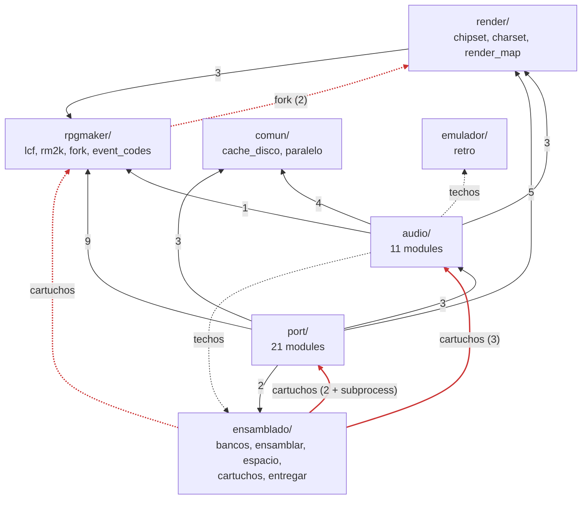
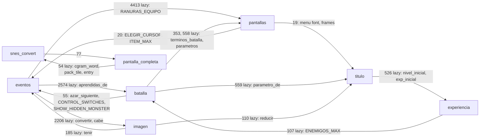

# The map of the Python tools

> **Snapshot of 2026-09-28, at commit `e314ff7b`** (snes-rm2k). The numbers
> are from that day and this file is not updated. The graph came from an AST
> script that was thrown away; appendix D includes it whole, so it can be run
> again on any commit. The rest came from reading the files, and every claim
> says what was read or what was searched for. No test covers this document.

taro asked for it: to understand the dependency graph of the `.py` files in
`tools/`, what responsibility each one has and what is agnostic to ABL. And,
with that, a plan in parts to get to two repos: on one side the tools and the
engine, which know nothing about any game; on the other, A Blurred Line.


## Summary

**Almost all of the Python in `tools/` is already agnostic in what it does.**
The only things about the game written into the code are two blocks of
content and some twenty loose knobs:

* the two blocks are the list of cartridges in `ensamblado/cartuchos.py` and
  the sound-effect and theme tables in `audio/snes_music.py`;
* the knobs are map IDs, asset names and defaults. They are in
  `snes_convert`, `eventos`, `escena`, `rm2k`, `render_map`, `snes_samples`,
  `msu`, `msu_datos` and `entregar`, and each one can be pulled out on its own
  (§3).

In `rom/src/` the code does not name any ABL ID. It is marked by three
identity constants —the title in the header, the SRAM signature and the
`.msu` signature— and a handful of assumptions of the kind "no actor in ABL
has a critical hit".

**What ties the repo to ABL is not knowing about the game, but the shape of
the tree.** Eleven modules compute the repo root from `__file__` and read
`data/`, `parches/`, `rom/src/`, `rom/build/` and `pruebas/casos/` from there.
The paths of the original game, the RTP and the SoundFont come from `ABL_*`
variables whose default is a path on the development machine. The border between the two
repos is exactly that: **what the project root is and what is inside it**.

**What cannot be separated yet is the tests.** The 114 test files
(`ls pruebas/*/test_*.py | wc -l`) run on ABL material, including the ones in
`rpgmaker/`, which test the engine. Only one escapes:
`herramientas/test_indice.py`. Until the wishlist's "golden game" exists, the
engine has nothing to be tested with outside ABL.

**The graph is better than `tools/README.md` says, but not the way it says.**

* The cycles are not three. In `port/` there is a single strongly connected
  component of six modules: `eventos`, `batalla`, `pantallas`, `imagen`,
  `titulo` and `experiencia`.
* There are also two cycles the README does not name: `snes_convert`↔
  `pantalla_completa` and, in the lowest layer, `lcf`↔`fork`.
* The layer violations come from just two files:
  * `ensamblado/cartuchos.py` imports from `port/` and from `audio/`, and runs
    `snes_convert.py` as a subprocess;
  * `rpgmaker/fork.py` imports from `render/`.
* All the cycles are broken by **moving** functions or constants, without
  changing logic (§4, step 1).

### The recommendation

Six steps, each verifiable separately, and **none of them requires waiting for
the golden game**. The order goes from the mechanical to the judgment calls:

1. **Untangle the graph by moving things.** It is mechanical and is verified
   with the ROMs identical byte for byte. It is what unblocks the most and
   costs the least.
2. **A single place that knows where the project is.** The eleven root
   computations become one function, and the `ABL_*` become flags that the
   ABL repo fills in. Also mechanical.
3. **The ABL knobs to a project file** in TOML. One knob per commit, with the
   same values, so the ROM does not change either.
4. **Split `cartuchos.py`** into the mechanism and ABL's list.
5. **Two roots in the same repo.** The engine on one side and ABL on the
   other, with a test that prevents the engine from naming the game's paths.
   It is a monorepo with the border already verified.
6. **The cut into two repos**, with `git filter-repo`: with the border already
   guarded by a test, it is mechanical.

How much of this is done before having the golden game is the first of the
questions for taro (§5).

**How it crosses with Rust.** Step 3 is the condition for each tool to be able
to be a binary: a tool with explicit inputs and no implicit root already has
the shape of a CLI. That is why **the project file has to be data (TOML) and
not a Python module**: an `import abl_config` could only be read by Python.
Splitting into two repos and moving to Rust are different axes. This cut makes
the other one easier as long as the border is made of data.


## 1. The graph

### How it was measured

The script in appendix D walks the AST of every `.py` in `tools/*/` and in
`pruebas/`. It classifies each import into three classes:

* **`import`**: a module-level import;
* **`lazy`**: an import inside a function, a class or the `if __name__`.
  These are the ones that hide the cycles today: Python does not see them on
  load;
* **`ruta`** (path): a string literal that *is* the path of another `.py`,
  like `cartuchos`'s subprocess.

The first version counted as `ruta` any text that *named* a `.py`,
docstrings and `help=` included, and gave a single component of thirty
modules: noise. With the whole literal as the path, two real edges remain:

* `cartuchos` runs `snes_convert.py` as a subprocess
  (`cartuchos.py:408-409`);
* `snes_convert` puts the hash of `rm2k`, `render_map`, `chipset` and
  `asignador` in its cache key (`snes_convert.py:1805-1809`).

The layers are those of `tools/README.md`. `rpgmaker`, `comun`, `ensamblado`
and `emulador` are one same row; above them goes `render`, then `audio` and at
the very top `port`. A violation is importing from the same row or a higher
one.

### By package

The arrows are imports between files of different packages, `import` and
`lazy` together; in parentheses, how many edges. In red, the ones that violate
the layers.



Read plainly:

* **`comun/`, `emulador/` and `ensamblado/{bancos,ensamblar,entregar}` are
  leaves**: they import nothing from `tools/`.
* **`render/` depends only on `rpgmaker/`**, and it is the only arrow that
  goes down cleanly.
* **`audio/` imports `render/` only for `GAME_DIR`, `RTP_DIR` and
  `find_resource`**, which are not about drawing (`snes_music.py:25`, 117,
  135 and 437; `msu.py:76`). They are the game's configuration and RM2k's
  resource lookup, and they live in `render_map.py:26-39` for historical
  reasons.
* **`cartuchos.py` is in the wrong layer.** It is the one that orchestrates
  everything, but it lives at the bottom.
  * From `port/` and `audio/` it uses only `tiles_bin.binario()`,
    `comprimir.binario()` and `muestras_brr.binario()`, which are
    `shutil.which` for the fingerprint (`cartuchos.py:270-271`).
  * It also uses `snes_music.leer_techos()`, to put `techos.toml` into the
    fingerprint (257-258), and `msu.armar()`, for the tracks (475).
  * And from `rpgmaker/` it uses `lcf.TreeMap`, for the rule of which maps go
    in (145).

### Inside `port/`: the strongly connected component



The script prints it like this, with `import` and `lazy` together:

    SCC: rpgmaker.fork, rpgmaker.lcf
    SCC: port.batalla, port.eventos, port.experiencia, port.imagen,
         port.pantallas, port.titulo
    SCC: port.pantalla_completa, port.snes_convert

With only module-level imports **there is no cycle at all**. Every one is
closed by a lazy import, which is what was used to dodge them.

What `tools/README.md` says about the cycles was checked like this:

* **`eventos`↔`batalla`**: still true.
* **`batalla`↔`pantallas`**: not direct. `pantallas` does not import
  `batalla`, and the cycle closes by going through `eventos`.
* **`eventos`↔`imagen`**: still true.
* **`titulo`'s palette helpers**: true, and it is more than the palette.
  `titulo.py` has at least three modules inside it, and none of them is about
  the title screen:
  * `reducir` and `convertir`, which are any image to N colors and any
    full-screen image to 8 bpp. They are used by `escena`, `animacion`,
    `imagen` and `pantalla_completa`;
  * the menus and the save slots;
  * the font and the frames of the menus. They are used by `pantallas`,
    `fin_del_juego` and `snes_convert`.

  Only `opciones`, `menu` and `COLORES` actually belong to the title
  (`snes_convert.py:7830-7841`).

### Who uses each module from outside

The full table, with lines, inputs and outputs, is in appendix A. The ones
that decide what each cut drags along are these:

| module | tests that import it | justfile |
|---|--:|---|
| `port/eventos` | 27 | |
| `render/render_map` | 22 (21 for `GAME_DIR`) | |
| `ensamblado/cartuchos` | 18 | `cartuchos`, `build`, `espacio` |
| `rpgmaker/lcf` | 13 | |
| `port/snes_convert` | 12 (almost all in `herramientas/`) | via `cartuchos` |
| `port/titulo` | 9 | |
| `port/batalla`, `rpgmaker/rm2k`, `audio/snes_music` | 7 each | |

The `justfile` recipes that run a `.py` by its path are `cartuchos`, `build`,
`espacio`, `entregar`, `parches`, `parches-check` and `techos`. In addition,
`protocolo` writes `port/event_opcodes.py` and `audio/music_opcodes.py`.


## 2. What each file does

Class: **A** is agnostic. **A+g** is agnostic with an ABL hook that can be
pulled out into configuration; the hook is in §3. **ABL** belongs to the game.
The criterion is whether it needs to know anything about *this* game to work.

| file | lines | what it does | class |
|---|--:|---|---|
| `rpgmaker/event_codes` | 20 | loads `event_codes.json` (from liblcf): command number ↔ name | A |
| `rpgmaker/lcf` | 940 | reads Ditto's dump in `data/`: `Map`, `Database`, `TreeMap` | A+g |
| `rpgmaker/rm2k` | 475 | RM2k's rules: passability, layers, poses, a page's graphic, translucent events | A+g |
| `rpgmaker/fork` | 584 | validates and applies `parches/manual/`: map forks, new maps, ChipSets by recipe | A+g |
| `comun/cache_disco` | 89 | disk cache with the hash of sources and binaries in the key | A+g |
| `comun/paralelo` | 63 | `en_paralelo`: the pure parts in forked processes | A |
| `ensamblado/bancos` | 423 | splits what was generated into banks and writes `ld65`'s `.cfg` | A (engine) |
| `ensamblado/ensamblar` | 227 | `ca65` + `ld65`, checksum, symbols; refuses if there is an `.inc` in `rom/src/` | A (engine) |
| `ensamblado/espacio` | 160 | how much each cartridge has left, read from the `.dbg` and the `.cfg` | A (engine) |
| `ensamblado/cartuchos` | 482 | which cartridges there are, with which flags and cases; builds them and decides whether they are stale | **mixed**: mechanism A, content ABL |
| `ensamblado/entregar` | 227 | copies `release` to the shared folder for taro | workflow; goes with ABL |
| `emulador/retro` | 441 | a libretro core from Python, frame by frame | A |
| `render/chipset` | 339 | a ChipSet to an atlas with the autotiles resolved | A |
| `render/charset` | 19 | a CharSet's measurements | A |
| `render/render_map` | 396 | a map's layers as images; **and** `GAME_DIR`, `RTP_DIR`, `find_resource` | A+g |
| `audio/midi` | 230 | minimal MIDI reader | A |
| `audio/musica` | 49 | from MIDI to notes and voices, without a chip | A |
| `audio/sdsp` | 267 | the S-DSP: registers, envelopes, volume | A |
| `audio/spc700` | 145 | minimal SPC700 assembler for the driver | A |
| `audio/music_opcodes` | 335 | generated by `protocol` from `music.toml` | A (engine) |
| `audio/muestras_brr` | 306 | bridge to Gunter, with a cache | A |
| `audio/snes_samples` | 345 | the sample bank from the SoundFont | A+g |
| `audio/efectos_msu` | 105 | at what rate each quality sound effect goes in the `.msu` | A |
| `audio/snes_music` | 2629 | MIDI → BRR + S-DSP stream; the per-map audio package | A+g, with an ABL stretch (269-417) |
| `audio/msu` | 354 | the MSU-1 PCM tracks with fluidsynth | A+g |
| `audio/techos` | 308 | measures each theme's peak in the ROM and writes `techos.toml` | A+g (what it writes belongs to ABL) |
| `port/event_opcodes` | 194 | generated by `protocol` from `events.toml` | A (engine) |
| `port/comprimir` | 117 | bridge to the `lz2` binary | A |
| `port/tiles_bin` | 123 | bridge to Voodoo | A |
| `port/asignador` | 217 | which colors are lost and how they are grouped into palettes | A |
| `port/experiencia` | 109 | experience curve and level-up (easyrpg) | A |
| `port/batalla` | 1185 | the battle model: formulas, AI, troop pages, turns | A (simplifies what ABL does not use) |
| `port/imagen` | 204 | the `ShowPicture` sign as objects | A |
| `port/pantalla_completa` | 68 | a full-screen image in an LZ2 stream | A |
| `port/animacion` | 350 | a battle animation in an OAM box | A (box measured on ABL) |
| `port/escena` | 567 | battle background and battlers composed on the console | A+g |
| `port/msu_datos` | 160 | the format of the data `.msu`: signature, index, backgrounds | A+g |
| `port/fin_del_juego` | 205 | the pause menu's `Scene_End` | A+g |
| `port/fuente` | 239 | easyrpg's 6x12 fonts, generated, ASCII only | A+g |
| `port/ventana` | 193 | the message window built from the System | A+g |
| `port/textos` | 371 | splits the `ShowMessage`s to the SNES width | A+g |
| `port/pantallas` | 925 | equipment, shop and the battle's text grid | A+g |
| `port/titulo` | 1713 | the title, **and** the menus, the save slots, the menu font and the color reduction | A+g |
| `port/parches` | 747 | writes and verifies the lossy decisions as TOML | A+g (what is versioned belongs to ABL) |
| `port/eventos` | 5515 | compiles event pages to bytecode | A+g |
| `port/snes_convert` | 9544 | the converter: from a game to `mapdata.inc`, `musicdata.inc` and the `.msu` | A+g |

### `snes_convert.py` by section

**No section belongs to ABL.** The functions (`grep -c '^def '`) were 132 that
day. It is worth distinguishing two kinds of agnostic:

* **RM2k tool**: reads the game and decides colors, tiles and palettes. It
  could be extracted as is;
* **engine**: emits what `rom/src/` expects, so it moves together with the
  assembler even though it knows nothing about the game.

| lines | section | main functions | class |
|---|---|---|---|
| 1-91 | imports; changes `lcf`'s `DECORAR_TRANSLUCIDO` and `REAJUSTAR_TEXTOS` | — | A (the docstring names ABL) |
| 92-406 | mode 3 background: CGRAM, quantization, 8 and 4 bpp tiles, the above layer | `bg_budget` 145, `pack_tile` 265, `cgram_word` 297, `convert_above` 367, `entry` 396 | RM2k |
| 407-758 | character sprites: colors, poses, palette, weight for the allocation | `sprite_colors` 442, `paleta_del_personaje` 512, `peso_de_grafico` 664 | RM2k, hook `PESO_DE_GRAFICO` 653 |
| 759-1252 | opaque events baked into the upper layer; drawable NPCs | `eventos_horneables` 799, `hornear_en_el_mapa` 959, `npcs_dibujables` 973 | RM2k |
| 1253-1742 | sprite bank and OAM extras: poses, timer, rain, sign, animation | `build_characters` 1253, `banco_de_poses` 1339, `npc_table` 1703 | RM2k |
| 1743-2132 | the map's layers, cached and in parallel | `capas_convertidas` 1815, `_convert_layers` 1913, `convert` 2028 | RM2k |
| 2133-2616 | the 64x32 tilemap window and the VRAM layouts | `vram_layout` 2424, `_controlar_repartos` 2550 | engine |
| 2617-2817 | message window and font | `convert_ventana` 2638, `fuente_bytes` 2746 | RM2k |
| 2818-3088 | 16x16 blocks with passability and terrain; `TileSubstitution` | `build_blocks` 2818, `Sustituciones` 2882 | RM2k |
| 3089-3564 | the per-map registry and the animations in `.inc` | `tabla_de_mapas` 3255, `animaciones_asm` 3470 | engine |
| 3565-3644 | experience curves | `experiencia_asm` 3578 | engine |
| 3645-4051 | which backgrounds and battlers the cartridge carries | `escena_de_la_rom` 3649, `escenas_asm` 3901 | engine, uses `escena.REEMPLAZO` |
| 4052-4583 | low-level emission, shared material, LZ2, encounters | `tabla_de_paginas` 4083, `Materiales` 4225, `comprimir_los_bloques` 4372 | engine |
| 4584-6780 | **`emit()`**: the whole `mapdata.inc`, in one function of ~2,200 lines | see below | engine |
| 6781-7187 | NPC and event tables, map order, save signature | `orden_de_mapas` 6899, `firma_de_la_partida` 6989, `actor_table_asm` 7160 | engine, `ANIMA_QUIETO_MAX` 6912 measured on ABL |
| 7188-7286 | the command line | `parser_de_flags` 7188 | ABL defaults |
| 7287-8288 | `main()`: orchestrates everything | — | A except for the defaults |
| 8289-8432 | the `.msu`: backgrounds and quality sound effects | `escribir_msu` 8289 | engine |
| 8433-8580 | which themes arrive already playing at each package | `temas_heredados` 8447, `temas_de_la_rom` 8534 | engine, hook `SALTOS_QUE_NO_SE_DAN` 8444 |
| 8581-8888 | analysis of the game: start-up, leaders, items, members | `lideres_posibles` 8624, `items_posibles` 8760 | RM2k, global `args_game_dir` 8757 |
| 8889-9008 | the test cases (`--caso`) | `partir_en_casos` 8892, `pagina_de_caso` 8983 | A (uses `eventos`'s reserved IDs) |
| 9009-9541 | `convertir()`: a whole map | `convertir` 9009 | RM2k |

`emit()` by stretch:

| lines | what it emits |
|---|---|
| 4603-5075 | header constants |
| 5076-5186 | map and pose tables |
| 5187-5230 | window, font and messages |
| 5231-5340 | sign, title and `pantallas_tabla` |
| 5340-5910 | save slots, items, shop, end, and the bank 0 tables |
| 5914-6190 | menu and equipment |
| 6190-6470 | skills, experience, save, common events and troops |
| 6470-6575 | encounters and enemies |
| 6575-6780 | battle constants and waits |

Who uses `snes_convert` from outside:

* `cartuchos`, as a subprocess;
* `pantalla_completa`, which imports `cgram_word`, `pack_tile` and `entry`:
  that is the cycle;
* ten tests in `herramientas/`, `rpgmaker/test_animacion_cuadros.py`
  (`cuadro_de_animacion`) and `abl/test_msu_datos.py` (`fondo_bytes`,
  `pack_tile`).

For [`las-responsabilidades-de-snes-convert`](https://github.com/lautarodragan/the-advocate-work/blob/main/tasks/las-responsabilidades-de-snes-convert.md), the cheapest thing is to
pull three things out into their own modules:

* **the SNES format** (92-406 and `entry`): breaks the cycle with
  `pantalla_completa`;
* **the VRAM layouts** (2133-2616): `test_repartos` already tests them on
  their own;
* **`emit()`**, split along the stretches of the table above.

### `eventos.py` by section

**No section belongs to ABL.** ABL's maps and characters appear in some forty
lines of comments. By range:

* **1-1308: the base.** Commands, panning, escapes, move routes, themes,
  graphics, fades and triggers.
* **1309-1482: the text block** (`Mensajes`).
* **1483-2283: the index of what the game uses.** Variables, items, rain,
  animations, `base_de_datos` with its cache (2091) and the single picture
  (`Imagenes` 2166).
* **2284-2927: the index of the whole game.** Variables, common events,
  actors, terms, skills and choices.
* **2928-3509: troops and random encounters.**
* **3510-5113: the compiler.** It has `compilar_pagina` (3630) and
  `_compilar` (4317).
* **5114-5515: what is left.** Party state, walkthroughs, reserved IDs
  (5202-5227), tint and saturation (5228-5314), `paginas_del_mapa` (5335) and
  `ruta_propia` (5457).

The hooks are in §3. What ties `eventos` to the rest of `port/` is little, and
it is in §4.


## 3. What belongs to ABL

### The hooks in the Python, in four classes

**a) Game data written into the code.** They go to the project file.

| where | what |
|---|---|
| `ensamblado/cartuchos.py:40-208` | all the content: `MENOR_A = 105`, `EXCLUIDOS` (16 maps with their reason), `AGREGADOS`, `MAPA_DE_DEBUG = 900`, `CON_MAPA_DE_DEBUG`, `MAPAS_DE_PRUEBA`, `GRAFICOS`, `release`'s `--grupo 10 --map-id 4`, the whole `test-special` cartridge, `FUERA`, and the case names `nada` and `mapa-de-debug` (222-223) |
| `audio/snes_music.py:269-417` | `SE_ENTEROS`, `SE_ENTEROS_PAGADOS`, `SE_DEL_MAPA`, `SE_DE_RUTA_SIN_PAQUETE`, `SE_DE_TROPA_AL_PAQUETE` and `TEMAS_APARTE`: tables tuned by ear, by map and by sound-effect name. They are also read by `eventos.py:4292-4313` and `snes_convert.py:8106` |
| `audio/snes_music.py:882` | `SE_DE_SIEMPRE = 92`, measured on ABL's `release` |
| `audio/snes_music.py:1997` | the path of `parches/auto/musica/techos.toml` |
| `port/snes_convert.py:653` | `PESO_DE_GRAFICO = {"savept": 2, "Future1": 1}` |
| `port/snes_convert.py:8444` | `SALTOS_QUE_NO_SE_DAN = {45: {20}}` |
| `port/escena.py:198` | `REEMPLAZO = "ABLBackdropSJ08"`, the replacement background |
| `rpgmaker/rm2k.py:284` | `SIN_TRAMA = frozenset({"savept"})` |
| `port/snes_convert.py:7193` | `--map-id` with default `7` |

**b) Identity and environment.** They go to flags or to the project file.

| where | what |
|---|---|
| `render/render_map.py:26`, `:36` | `GAME_DIR` and `RTP_DIR`, from `ABL_GAME_DIR` and `ABL_RTP_DIR`, defaulting to a path on the development machine. They are read by `snes_music`, `msu`, `snes_convert`, `escena` and 21 tests; the `justfile` and `abl/test_hover_tram.py` repeat the default |
| `port/snes_convert.py:7194-7196`, `:8757` | `--game-dir` and `-o` defaulting to this repo; the global `args_game_dir` |
| `audio/snes_samples.py:48-50` | `ABL_SOUNDFONT`, defaulting to a `.sf2` chosen for ABL (the synthesizer it was composed with) |
| `audio/msu.py:90` | `REEMPLAZOS`, a fixed path on the development machine with ABL's track replacements |
| `comun/cache_disco.py:38` | `ABL_CACHE`: only the name |
| `rpgmaker/lcf.py:41-42`, `rpgmaker/fork.py:59-67` and 5 more places in `fork.py` | `data/` and `parches/manual/` as fixed paths under the root |
| `ensamblado/cartuchos.py:337`, `audio/techos.py:147`, `:269`, `ensamblado/entregar.py` (several) | the name `abl.sfc` / `abl.msu` / `abl-*.pcm`, repeated by hand |
| `port/msu_datos.py:78` | `MAGIA = b"ABLD"`, the signature of the data `.msu`, which the ROM compares |
| eleven modules | the repo root, computed from `__file__`: `cache_disco`, `entregar`, `techos`, `cartuchos`, `espacio`, `ensamblar`, `render_map`, `fork`, `lcf`, `snes_music` twice (`TECHOS`, `RAM_LEJANA`) and `parches.py:659` |

**c) Engine limits measured on ABL.** They are not game data: they are engine
assumptions that another game could break. **They do not go to the project
file.** They stay in the engine, and the question is whether they fail loudly
when they are not enough (§5).

* **Constants sized for ABL**:
  * `eventos.py:1653` `ITEMS_N = 451`, the items in ABL's LDB, which could be
    taken from `len(db.items)`;
  * `:1434` `MENSAJES_PASO = 4`;
  * `:1639` `VAR_RANURA_MAX`;
  * `:2773` `SWITCH_MAX`.
* **Values measured on ABL, which could be read from the LDB**:
  * `eventos.py:1071` `FUNDIDO_CUADROS = 35`, which assumes transition 0/0;
  * `:3262` `ENC_RATE = 100`, plus the assumption that no troop filters by
    terrain.
* **The reserved IDs**: `eventos.py:5202` `SWITCH_DE_PRUEBA = 1023`, `:5215`
  `VARIABLE_DE_CASO = 1000` and `:5222` `SWITCH_IMPOSIBLE = 1021`. They are
  free numbers *in ABL*, and they are also used by `cartuchos`, the harness
  and `rm2k.py:301`.
* **Widths and measurements**:
  * `ventana.py:49` `COLUMNAS = 39`, measured on ABL's lines;
  * the widths in `pantallas.py` (104, 106, 687, 703-709, 750, 821);
  * those in `titulo.py` (763, 1444);
  * the title's `MENU_X`/`MENU_Y` (205-209), placed over ABL's art;
  * `snes_convert.py:6912` `ANIMA_QUIETO_MAX`;
  * the box of 64 in `animacion.py:53`.
* **Text and font**:
  * ASCII only (`eventos.py:1452-1455`, `fuente.py`);
  * `cp1252` in `fin_del_juego.py:59`;
  * `MINCHO` by default (`fuente.py:226`, `ventana.py:164`);
  * `es_hablante` in `textos.py:95-109`, ABL's convention of writing the
    speaker's name in capitals;
  * `VACIA = "- Empty -"` in `titulo.py:336`.
* **`batalla.py`'s simplifications**: it does not read the weapon's `hit`
  (548-553), it ignores `first_strike` (822-825), and pages conditioned on a
  variable raise `NotImplementedError` (651).
* **The volume**: `sdsp.py:219-222`, `AIRE` and the ceilings, tuned on ABL's
  themes.

**d) Prose.** The comments and docstrings name ABL's maps, characters and
themes in every large file. Some of them, moreover, **are emitted into the
`.inc`** (`snes_convert.py:3270-3276`, 4662-4673). They change nothing about
what the code does.

### What is not Python

| what | whose | what was read or searched for |
|---|---|---|
| `rom/src/` (93 `.s`) | **engine**, except for three constants | A grep for ABL names and numbers outside comments finds nothing; everything about the game comes in through `mapdata.inc` and `musicdata.inc`, which the converter generates. The constants are `cabecera.s:12` `"A BLURRED LINE"`, `partida.s:45` the SRAM signature `"ABLS"` (copied in `pruebas/arnes/consola.py:62`) and, on the converter side, the `.msu`'s `"ABLD"`. The assumptions are of class c's kind: no critical hit (`batalla.s:397`), four save slots (`partida.s:24`), the fixed battle transition (`fundido_de_pelea.s`) |
| `rom/src/*_opcodes.inc` | engine | generated by `protocol` |
| `parches/` | **engine mechanism, ABL content** | `auto/` (maps, animations, battlers, `techos.toml`) comes from running the converter on ABL; `manual/` (6 forks, 3 ChipSets by recipe, debug map 900) is a hand redesign of ABL. The format and the rules live in `fork.py`, `parches.py` and the two READMEs, which mix the rules with "what is forked today" |
| `data/` | ABL | it is the game, dumped. `data/README.md` describes Ditto's format: it could go with Ditto |
| `pruebas/casos/` (242 JSON) | ABL | 237 start with a `Teleport` to an ABL map; the others use ABL's troops |
| `pruebas/golden/` | ABL | captures of ABL's and the RTP's art: they cannot be published |
| `pruebas/rpgmaker/` | **engine by intent, ABL by material** | all 67 files use ABL's maps, themes or data |
| `pruebas/herramientas/` | almost all ABL by material | 20 of 21 use `GAME_DIR`, `data/` or a cartridge; the agnostic one is `test_indice.py` |
| `pruebas/abl/` | ABL | — |
| `pruebas/arnes/` | **mixed** | agnostic: `dibujo`, `menu`, `lz2`. Generic with leftovers of ABL: `consola` (the `ABLS` signature, the "Begin the Story" options), `tanda` and `datos`. ABL's: `recorrido`, `piedras`, `batalla` and `video` |
| `justfile` | mixed | the engine's: `protocolo*`, `gunter-`, `voodoo-` and `lz2-pruebas`, `herramientas`, `cartuchos`, `build` and `espacio`. ABL's: `datos`, `ditto-*` (because of the default corpus), `pruebas-abl`, `parches*`, `techos`, `entregar` and `video` |
| `workflow/` | mixed | `decisiones/` and `divergencias/` belong to the engine, even though they measure with ABL's maps. `tasks/` is mostly ABL |
| `docs/` | engine | `rpgmaker/`, `snes/`, `port/` and `research/`, with ABL examples |
| `README.md`, `AGENTS.md` | both | the README mixes the game with the architecture; `AGENTS.md` is almost all working rules, except "Dónde corre esto" (where this runs) |
| `DITTO.md` | whichever repo uses `data/` as the source of truth | it says itself that it stays if Ditto moves |

About licenses:

* there is no license file in the repo (`find -iname '*licen*'`);
* the game and the RTP already live outside, on purpose, behind
  `ABL_GAME_DIR` and `ABL_RTP_DIR`;
* but `data/` (31 MB) and `pruebas/golden/` (5.5 MB) are material derived
  from ABL and the RTP, and they are versioned. **Neither of the two can go
  into a public engine repo, nor into its history.**


## 4. The plan

The rule is the one in AGENTS.md: **first the mechanical part, alone in its
commit and verified; then the judgment calls.** In this repo, verified means
three things:

* `just cartuchos` gives all the ROMs byte for byte identical to the ones
  before;
* `just pruebas` is green;
* the script in appendix D shows what the step promised.

Steps 1 to 3 all leave the ROMs identical, because they do not change any
value.

### Step 1: untangle the graph by moving things (mechanical)

Each item goes in its own commit. The order is by what it unblocks:

1. **`GAME_DIR`, `RTP_DIR` and `find_resource` leave `render_map` for
   `rpgmaker/`**, for example a `rpgmaker/recursos.py`. With that `audio/`
   stops importing `render/`, and the eleven root readers have somewhere to
   converge in step 2.
2. **The ChipSet and CharSet geometry** (`caja_de_terreno`, `caja_de_comun`,
   `TILE`, `SPRITE_*`) **moves down to `rpgmaker/rm2k.py`**, which already
   duplicates `POSE_W` and `POSE_H`. `fork.py` stops importing `render/`.
3. **`lcf`↔`fork`.** There are two ways to break it:
   * `fork` receives the `Map` instead of importing it;
   * or `fork`'s image part (`podar`, `_pose`, `imagen_del_chipset`,
     `imagenes`) moves up to `render/`, and `fork` remains as JSON
     validation.

   The second is the one that leaves `rpgmaker/` without PIL.
4. **`cartuchos` stops importing `port/` and `audio/`.**
   * The three `binario()` are `shutil.which` of a name: a list is enough.
   * `leer_techos` is reading a TOML.
   * `pistas()` is orchestrated from the recipe.

   The alternative is to declare that `cartuchos` is the very top layer, and
   that is the honest thing: it is the one that orchestrates. That requires
   moving it, and it is a question for §5.
5. **`port/`'s strongly connected component**, with seven moves and no new
   logic:
   * `batalla.aprendidas_de` → `eventos`, or to a module of RM2k rules;
   * `pantallas.RANURAS_EQUIPO` and `batalla.ENEMIGOS_MAX` → a constants
     module;
   * `eventos.tenir` and its helpers (5228-5314) → a `port/color.py`;
   * `titulo.reducir` and `titulo.convertir` → a `port/paleta.py`;
   * `ventana.LINEAS` and `ventana.COLUMNAS` → constants. That way importing
     `eventos` stops loading PIL and `render_map`;
   * `titulo.parametro_de` and `nivel_de`, and `pantallas.terminos_batalla`
     and `parametros` → RM2k rules.

   With that done, `eventos` remains as a leaf on the engine side.
6. **`pack_tile`, `cgram_word` and `entry` leave `snes_convert`** for a
   module of the SNES format. It breaks the cycle with `pantalla_completa`,
   and it is the first cut of [`las-responsabilidades-de-snes-convert`](https://github.com/lautarodragan/the-advocate-work/blob/main/tasks/las-responsabilidades-de-snes-convert.md).
7. **`titulo.py` is split into title, menus and save slots, and menu font.**
   It is moving, but it is a lot of moving: better to leave it after the other
   six.

At the end, the script has to print **no strongly connected component and no
violation**, and `tools/README.md` is rewritten with the real graph.

### Step 2: a single place that knows where the project is (mechanical)

A new module, `comun/proyecto.py`, with a function `raiz()` that today returns
the same thing the eleven computations return. Those eleven switch to using
it, and so do the paths derived from it:

* `data/`, `parches/manual/`, `parches/auto/`;
* `rom/src/`, `rom/build/`, `pruebas/casos/`.

And the environment defaults —the game, the RTP, the SoundFont, the MSU-1
replacements— are read in **one** place.

The interface does not change yet: it is gathering what is scattered, so that
step 3 touches one file and not eleven. It is verified the same way as
step 1.

### Step 3: the ABL knobs to a project file (judgment)

A data file at the project root —in TOML, because Rust already reads it
(`protocol`)— with what is in classes a and b of §3:

```toml
# sketch, not a closed proposal
[rom]
nombre = "abl"                    # abl.sfc, abl.msu, abl-N.pcm
titulo = "A BLURRED LINE"         # the header, 21 characters
firma_sram = "ABLS"               # changing it invalidates taro's saves
firma_msu = "ABLD"

[juego]
mapa_inicial = 4
grupo = [10]

[graficos]
peso = { savept = 2, Future1 = 1 }
sin_trama = ["savept"]
fondo_de_reemplazo = "ABLBackdropSJ08"

[audio]
# the tables in snes_music.py:269-417, SE_DE_SIEMPRE and the jumps that do not happen

[cartuchos]
# what is in cartuchos.py:40-208
```

It goes **one knob per commit**, with the same value, and the ROM has to come
out identical. The SRAM signature and the title have a catch: they come out of
the converter into an `.inc`, so they touch `rom/src/`. It is the only place
in the step where the assembler changes, and it changes without changing
bytes.

The environment paths do **not** go in the file, because they are not the
project's but the machine's. The `.py` files stop reading the `ABL_*` and
receive `--game-dir`, `--rtp-dir` and `--soundfont`. The ABL repo's `justfile`
is the one that translates `$ABL_GAME_DIR` into a flag.

That way each tool ends up with **explicit inputs**: the project root, the
environment flags, and nothing implicit. That is what makes it replaceable by
a binary.

### Step 4: split `cartuchos.py` (judgment)

The mechanism stays on the engine side: `huella`, `sello`, `viejo`, `armar`,
`convertir`, `manifiesto` and `main` (242-482).

What belongs to ABL goes to the project file: the rule of which maps go in,
the exclusions with their reasons, the cartridges and their cases. The
reasons in `EXCLUIDOS` are prose that today lives in comments, and in TOML
they are still comments.

The `900` of the debug map has to come from `fork.nuevos()` and not be
written twice.

### Step 5: two roots in the same repo (mechanical, with a new safety net)

Before splitting the repo, the tree has to be split:

* `motor/`, with `rom/src/`, `tools/` without `entregar`,
  `docs/rpgmaker|snes|port`, `workflow/decisiones` and
  `workflow/divergencias`;
* `abl/`, with `data/`, `parches/`, `pruebas/`, the project file, ABL's
  `justfile` and `entregar`.

The names are to be decided. With that, a new test enforces the border:
**no file in `motor/` names a path in `abl/`, nor an `ABL_*` variable**. It is
the same kind of safety net as `test_protocolo`, which enforces that
`rom/src/` does not declare opcodes by hand.

Moving is free in the ROM but not in `blame`: this repo's whys live in the
`git log`. That is why this step takes the same precautions as the `main.s`
split, `-C` and histogram, and it is checked on a sample before calling it
done.

### Step 6: the cut (mechanical)

With `git filter-repo`, twice, once per root. The engine's history **cannot**
carry `data/` or `pruebas/golden/` (§3, licenses), so the filter is by path,
and the paths changed twice:

* the move to `tools/*/` of 2026-09-19;
* the `main.s` split of 2026-09-25.

It has to filter with all the historical names, and check afterwards, with an
empty `git log --all -- data/` in the engine repo, that nothing was left.

### What happens to the tests and the goldens

**Until there is a golden game, the tests live with ABL**, because they all
use its material. So the engine repo comes out with the Rust projects' tests,
`test_indice` and little else.

What can be prepared without the golden game:

* **Split the harness.** `consola`, `tanda`, `dibujo`, `menu`, `lz2` and
  `datos` go to the engine, without the fixed `ABLS` signature —it comes from
  the project file— and without ABL's title options. `recorrido`, `piedras`,
  `batalla` and `video` stay with ABL.
* **`pruebas/casos/`** is the embryo of the golden game, as the wishlist
  says: the case format belongs to the engine, the 242 cases belong to ABL.
  When the golden game exists, each `rpgmaker/` case is rewritten against one
  of its maps. That is how a test moves to another repo.
* **The goldens go with their game.** ABL's stay with ABL. The golden game
  brings its own, which can be published if its assets can be published:
  that is the wishlist's licensing blocker.

### How it crosses with Rust

* Steps 2 and 3 are the ones that get closer to Rust: a tool that receives
  everything explicitly already has the shape of a binary.
* **What would get in the way is the border being Python.** If the project
  file is a module, every future binary would have to embed an interpreter or
  duplicate it; if it is TOML, anyone can read it.
* The obvious candidates for a binary, when the time comes, are leaves that
  are already agnostic and have clear inputs and outputs:
  * `render/`: a map to images;
  * `asignador`;
  * the audio chain without its tables: from `midi` to `snes_music`.
* `snes_convert` is the last one, and only after it is split.
* Nothing in the plan requires waiting for Rust, nor the other way around.


## 5. Questions for taro

1. **Is it separated before or after the golden game?**
   * a) Do steps 1 to 5 now, and cut (step 6) only once the golden game has
     started.
   * b) Cut now: the engine comes out without ROM tests of its own, and the
     ABL repo runs them.
   * c) Wait for the golden game for everything.

   **I recommend a).** Steps 1 to 5 are worth it on their own, because they
   tidy up the graph and make the border explicit. And cutting with the
   engine without tests leaves the repo one wants to publish without a safety
   net.

2. **How does ABL consume the engine?**
   * a) Git submodule, pinned by commit.
   * b) Installed from the PATH, like the Rust projects.
   * c) For a while, a monorepo with two roots (step 5).

   **I recommend c) first and a) later.** ABL's goldens are captures of *one*
   version of the engine, so ABL needs to pin the version, and a submodule
   pins by commit. "From the PATH" works for stable tools, but the engine
   changes with every feature of the game.

3. **One repo or two on the agnostic side?**
   * a) Just one: RM2k tools, converter and `rom/src/` together.
   * b) Two: the RM2k tools that know nothing about the SNES (`rpgmaker/`,
     `render/`, Ditto) on one side; the SNES engine (`port/`, `audio/`,
     `ensamblado/`, `rom/src/`) on the other.

   **I recommend a) for now.** The contract between the converter and the
   assembler is the generated `.inc` files, and separating them requires
   versioning that contract. `protocol` already does it for the opcodes, but
   not for `mapdata.inc`.

4. **What language does the engine repo end up in?** The AGENTS.md rule says
   that what knows nothing about the game goes in English, and the engine
   would become that: thirty-two thousand lines of Python and 93 assembly
   files, in Spanish.
   * a) Exception: the engine stays in Spanish.
   * b) Translate it before publishing it.
   * c) Translate each part when it is rewritten, for example when moving to
     Rust.

   **I recommend c).** Translating everything is a change with no safety net
   to verify the prose, and the move to Rust rewrites it anyway.

5. **The engine limits measured on ABL (class c of §3): are they derived from
   the data or left alone?**
   * a) Leave them, and have the converter fail loudly when another game does
     not fit. Many already do: `ITEMS_N` is enforced by `test_items.py`, and
     `_controlar_repartos` stops if it does not fit.
   * b) Derive the ones that can be: `ITEMS_N` from `len(db.items)`, the fade
     from the LDB's transitions, `ENC_RATE` from the terrain.

   **I recommend a) today and b) case by case when the golden game asks for
   it.** Each one is a feature, not a refactor.

6. **Where does `cartuchos.py` live?**
   * a) At the very top, in an orchestration layer of its own.
   * b) In `ensamblado/`, without the upward imports (step 1.4).

   **I recommend a).** It is what it already is.

7. **Is the history kept in both repos?** `git filter-repo` keeps it, but with
   two risks: the path renames and `data/` slipping in. Starting from scratch
   loses the record, which in this repo *is* the `git log`. **I recommend
   keeping it**, with step 6's check.

8. **`workflow/`**: do `decisiones/` and `divergencias/` go with the engine?
   **I recommend yes**, rewriting the ABL examples when they are touched and
   not before. `tasks/` stays with ABL, and the engine starts an empty one.

9. **The comments that name ABL in the engine** (class d): are they cleaned
   up for publishing? **I recommend not**: they are the whys, and ABL is the
   game with which everything was measured. What is worth cleaning up is what
   is **emitted** into the `.inc` and the command line's `help=`.

### What I don't know

* **Whether step 1.5 leaves the ROMs identical is for the run to say, not the
  reading.** Moving functions should not change bytes, but `cache_disco` puts
  the hash of the sources in the key. If `snes_convert.py:1805-1809` lists
  files that move, that list has to be updated in the same commit, or the
  cache is left lying. Verify with `SIN_CACHE=1`, as AGENTS.md asks.
* **I did not review the internal dependencies** of `pantallas.parametros` or
  `terminos_batalla` (step 1.5): they may drag along more than it seems.
* **I did not measure how much of `pruebas/rpgmaker/` could be rewritten**
  against a small golden game. It is the estimate that decides when it is
  worth cutting.
* **The licenses of the SoundFonts and of the system font** remain as the
  wishlist left them: unexamined.


## Appendix A: by module

Output of the script's `tabla()` (appendix D). "Imports" and "imported by"
count distinct modules of `tools/` (`import` + `lazy`); "tests" counts files
in `pruebas/`; "justfile" is whether a line that is not a comment names its
path.

| module | lines | imports (tools) | imported by (tools) | imported by (tests) | justfile |
|---|--:|--:|--:|--:|---|
| `rpgmaker/event_codes` | 20 | 0 | 2 | 0 |  |
| `rpgmaker/fork` | 584 | 3 | 3 | 1 |  |
| `rpgmaker/lcf` | 940 | 2 | 10 | 13 |  |
| `rpgmaker/rm2k` | 475 | 1 | 3 | 7 |  |
| `comun/cache_disco` | 89 | 0 | 4 | 0 |  |
| `comun/paralelo` | 63 | 0 | 3 | 0 |  |
| `ensamblado/bancos` | 423 | 0 | 2 | 3 |  |
| `ensamblado/cartuchos` | 482 | 7 | 3 | 18 | yes |
| `ensamblado/ensamblar` | 227 | 0 | 2 | 3 | yes |
| `ensamblado/entregar` | 227 | 0 | 0 | 0 | yes |
| `ensamblado/espacio` | 160 | 3 | 0 | 1 | yes |
| `emulador/retro` | 441 | 0 | 1 | 4 |  |
| `render/charset` | 19 | 1 | 2 | 0 |  |
| `render/chipset` | 339 | 0 | 3 | 1 |  |
| `render/render_map` | 396 | 5 | 7 | 22 |  |
| `audio/efectos_msu` | 105 | 3 | 1 | 0 |  |
| `audio/midi` | 230 | 0 | 1 | 1 |  |
| `audio/msu` | 354 | 4 | 1 | 0 |  |
| `audio/muestras_brr` | 306 | 1 | 4 | 1 |  |
| `audio/music_opcodes` | 335 | 0 | 1 | 2 | yes |
| `audio/musica` | 49 | 0 | 1 | 0 |  |
| `audio/sdsp` | 267 | 0 | 2 | 2 |  |
| `audio/snes_music` | 2629 | 10 | 6 | 7 |  |
| `audio/snes_samples` | 345 | 2 | 3 | 0 |  |
| `audio/spc700` | 145 | 0 | 1 | 0 |  |
| `audio/techos` | 308 | 4 | 0 | 1 | yes |
| `port/animacion` | 350 | 3 | 1 | 2 |  |
| `port/asignador` | 217 | 0 | 3 | 0 |  |
| `port/batalla` | 1185 | 4 | 3 | 7 |  |
| `port/comprimir` | 117 | 0 | 3 | 1 |  |
| `port/escena` | 567 | 3 | 1 | 2 |  |
| `port/event_opcodes` | 194 | 0 | 1 | 1 | yes |
| `port/eventos` | 5515 | 10 | 6 | 27 |  |
| `port/experiencia` | 109 | 1 | 2 | 3 |  |
| `port/fin_del_juego` | 205 | 3 | 1 | 1 |  |
| `port/fuente` | 239 | 0 | 4 | 0 |  |
| `port/imagen` | 204 | 2 | 2 | 0 |  |
| `port/msu_datos` | 160 | 0 | 1 | 2 |  |
| `port/pantalla_completa` | 68 | 3 | 1 | 0 |  |
| `port/pantallas` | 925 | 4 | 3 | 4 |  |
| `port/parches` | 747 | 1 | 1 | 1 | yes |
| `port/snes_convert` | 9544 | 27 | 1 | 12 |  |
| `port/textos` | 371 | 2 | 1 | 1 |  |
| `port/tiles_bin` | 123 | 0 | 2 | 0 |  |
| `port/titulo` | 1713 | 6 | 8 | 9 |  |
| `port/ventana` | 193 | 2 | 6 | 4 |  |

## Appendix B: the graph by file

Output of the "ARISTAS POR ARCHIVO" (edges by file) section. No mark means
`import`; `[lazy]` is an import inside a function; `[ruta]` is a literal with
the file's path.

    rpgmaker.event_codes ->
    rpgmaker.fork        -> rpgmaker.lcf[lazy], render.chipset[lazy], render.charset[lazy]
    rpgmaker.lcf         -> rpgmaker.fork, rpgmaker.event_codes
    rpgmaker.rm2k        -> rpgmaker.lcf
    comun.cache_disco    ->
    comun.paralelo       ->
    ensamblado.bancos    ->
    ensamblado.cartuchos -> audio.muestras_brr, ensamblado.ensamblar, port.tiles_bin,
                            port.comprimir, rpgmaker.lcf[lazy], audio.snes_music[lazy],
                            audio.msu[lazy], port.snes_convert[ruta]
    ensamblado.ensamblar ->
    ensamblado.entregar  ->
    ensamblado.espacio   -> ensamblado.bancos, ensamblado.ensamblar, ensamblado.cartuchos[lazy]
    emulador.retro       ->
    render.charset       -> render.chipset
    render.chipset       ->
    render.render_map    -> render.charset, rpgmaker.fork, rpgmaker.lcf, rpgmaker.rm2k,
                            render.chipset
    audio.efectos_msu    -> audio.muestras_brr, audio.snes_music, audio.snes_samples
    audio.midi           ->
    audio.msu            -> audio.snes_music, audio.snes_samples, comun.cache_disco,
                            render.render_map
    audio.muestras_brr   -> comun.cache_disco
    audio.music_opcodes  ->
    audio.musica         ->
    audio.sdsp           ->
    audio.snes_music     -> rpgmaker.lcf, audio.musica, audio.midi, audio.muestras_brr,
                            audio.sdsp, audio.snes_samples, audio.spc700, comun.paralelo,
                            render.render_map[import/lazy], audio.music_opcodes
    audio.snes_samples   -> audio.muestras_brr, comun.cache_disco
    audio.spc700         ->
    audio.techos         -> audio.sdsp, audio.snes_music, emulador.retro[lazy],
                            ensamblado.cartuchos[lazy]
    port.animacion       -> render.render_map[lazy], port.eventos[lazy], port.titulo[lazy]
    port.asignador       ->
    port.batalla         -> port.eventos, rpgmaker.lcf[lazy], port.pantallas[lazy],
                            port.titulo[lazy]
    port.comprimir       ->
    port.escena          -> render.render_map[lazy], port.titulo[lazy], port.asignador[lazy]
    port.event_opcodes   ->
    port.eventos         -> rpgmaker.rm2k, port.event_opcodes, port.ventana[lazy],
                            rpgmaker.fork[lazy], rpgmaker.lcf[lazy], port.imagen[lazy],
                            comun.paralelo[lazy], port.batalla[lazy],
                            audio.snes_music[lazy], port.pantallas[lazy]
    port.experiencia     -> port.batalla[lazy]
    port.fin_del_juego   -> port.titulo, port.ventana, port.fuente[lazy]
    port.fuente          ->
    port.imagen          -> port.titulo[lazy], port.eventos[lazy]
    port.msu_datos       ->
    port.pantalla_completa -> port.comprimir, port.titulo, port.snes_convert[lazy]
    port.pantallas       -> port.titulo[import/lazy], port.eventos, port.ventana[lazy],
                            rpgmaker.lcf[lazy]
    port.parches         -> ensamblado.cartuchos[lazy]
    port.snes_convert    -> ensamblado.bancos, port.tiles_bin, port.comprimir,
                            rpgmaker.event_codes, port.eventos, rpgmaker.lcf,
                            rpgmaker.rm2k[import/ruta], port.textos, port.animacion,
                            port.imagen, port.asignador[import/ruta], port.parches,
                            port.titulo, port.pantalla_completa, port.fin_del_juego,
                            port.pantallas, port.batalla, port.experiencia, port.escena,
                            port.msu_datos, audio.efectos_msu, comun.paralelo,
                            audio.snes_music, render.render_map[import/ruta],
                            comun.cache_disco[lazy], port.ventana[lazy],
                            port.fuente[lazy], render.chipset[ruta]
    port.textos          -> port.eventos, port.ventana
    port.tiles_bin       ->
    port.titulo          -> port.asignador, port.fuente, port.ventana[lazy],
                            port.experiencia[lazy], render.render_map[lazy],
                            rpgmaker.lcf[lazy]
    port.ventana         -> render.render_map, port.fuente[lazy]

## Appendix C: the layer violations, one per line

    rpgmaker.fork:351        -> render.chipset      [lazy]
    rpgmaker.fork:427        -> render.charset      [lazy]
    rpgmaker.fork:447        -> render.charset      [lazy]
    rpgmaker.fork:448        -> render.chipset      [lazy]
    ensamblado.cartuchos:28  -> audio.muestras_brr  [import]
    ensamblado.cartuchos:30  -> port.tiles_bin      [import]
    ensamblado.cartuchos:31  -> port.comprimir      [import]
    ensamblado.cartuchos:145 -> rpgmaker.lcf        [lazy]   (same row)
    ensamblado.cartuchos:257 -> audio.snes_music    [lazy]
    ensamblado.cartuchos:475 -> audio.msu           [lazy]
    ensamblado.cartuchos:409 -> port.snes_convert   [ruta]   (subprocess)

## Appendix D: the script

It is run with `python3 grafo.py <repo root>` and needs nothing outside the
standard library. The snapshot was taken with Python 3.14. It prints the
sections that appendices A to C cite, and the cycles, in three variants: only
`import`, `import` + `lazy`, and the three classes together.

```python
#!/usr/bin/env python3
"""Import graph of tools/ (AST), plus who uses it from pruebas/ and justfile.

Edges:
  import : module-level import
  lazy   : import inside a function, class or the `if __name__`
  ruta   : a string literal that IS the path of another .py in tools/
"""
import ast, collections, os, re, sys

RAIZ = os.path.abspath(sys.argv[1])
TOOLS = os.path.join(RAIZ, "tools")
CAPAS = ["rpgmaker", "comun", "ensamblado", "emulador", "render", "audio", "port"]
NIVEL = {"rpgmaker": 0, "comun": 0, "ensamblado": 0, "emulador": 0,
         "render": 1, "audio": 2, "port": 3}

MODS = {f"{d}.{f[:-3]}": os.path.join(TOOLS, d, f)
        for d in CAPAS for f in sorted(os.listdir(os.path.join(TOOLS, d)))
        if f.endswith(".py") and f != "__init__.py"}
POR_NOMBRE = {m.split(".")[1]: m for m in MODS}


def imports_de(ruta, base_pkg=None):
    arbol = ast.parse(open(ruta, encoding="utf-8").read(), ruta)
    aristas = []

    def visitar(nodo, lazy):
        for h in ast.iter_child_nodes(nodo):
            if lazy:
                es_lazy = True
            elif isinstance(h, (ast.FunctionDef, ast.AsyncFunctionDef, ast.ClassDef)):
                es_lazy = True
            elif isinstance(h, ast.If):
                t = h.test
                es_lazy = (isinstance(t, ast.Compare) and isinstance(t.left, ast.Name)
                           and t.left.id == "__name__")
            else:
                es_lazy = False
            tipo = "lazy" if lazy else "import"
            if isinstance(h, ast.Import):
                aristas.extend((a.name, tipo, h.lineno) for a in h.names if a.name in MODS)
            elif isinstance(h, ast.ImportFrom):
                mod = (base_pkg + ("." + h.module if h.module else "")
                       if h.level and base_pkg else h.module or "")
                if mod in MODS:
                    aristas.append((mod, tipo, h.lineno))
                else:
                    aristas.extend((f"{mod}.{a.name}", tipo, h.lineno)
                                   for a in h.names if f"{mod}.{a.name}" in MODS)
            visitar(h, es_lazy)

    visitar(arbol, False)
    for n in ast.walk(arbol):
        if isinstance(n, ast.Constant) and isinstance(n.value, str):
            v = n.value.strip()
            if re.fullmatch(r"[\w./-]*\.py", v):        # a path, not prose
                m = os.path.basename(v)[:-3]
                if m in POR_NOMBRE:
                    aristas.append((POR_NOMBRE[m], "ruta", getattr(n, "lineno", 0)))
    return aristas


GRAFO = {m: [a for a in imports_de(r, m.split(".")[0]) if a[0] != m]
         for m, r in MODS.items()}

print("## ARISTAS POR ARCHIVO")
for m in MODS:
    ds = collections.OrderedDict()
    for d, t, _ in GRAFO[m]:
        ds.setdefault(d, set()).add(t)
    print(m, "->", ", ".join(d + ("" if ts == {"import"} else f"[{'/'.join(sorted(ts))}]")
                             for d, ts in ds.items()))

print("\n## VIOLACIONES DE CAPA")
for m in MODS:
    a = m.split(".")[0]
    for d, t, l in GRAFO[m]:
        b = d.split(".")[0]
        if a != b and NIVEL[b] >= NIVEL[a]:
            print(f"{m}:{l} -> {d} [{t}]")

print("\n## CICLOS")
sys.setrecursionlimit(10000)
for incluir in (("import",), ("import", "lazy"), ("import", "lazy", "ruta")):
    ady = {m: sorted({d for d, t, _ in GRAFO[m] if t in incluir}) for m in MODS}
    idx, low, pila, en, c = {}, {}, [], set(), [0]

    def tarjan(v):
        idx[v] = low[v] = c[0]; c[0] += 1; pila.append(v); en.add(v)
        for w in ady[v]:
            if w not in idx:
                tarjan(w); low[v] = min(low[v], low[w])
            elif w in en:
                low[v] = min(low[v], idx[w])
        if low[v] == idx[v]:
            comp = []
            while True:
                w = pila.pop(); en.discard(w); comp.append(w)
                if w == v:
                    break
            if len(comp) > 1:
                print(" + ".join(incluir), "SCC:", ", ".join(sorted(comp)))

    for v in MODS:
        if v not in idx:
            tarjan(v)

print("\n## TABLA")
entra = collections.defaultdict(set)
for m, ar in GRAFO.items():
    for d, t, _ in ar:
        if t != "ruta":
            entra[d].add(m)
usos = collections.defaultdict(set)
for dp, _, fs in os.walk(os.path.join(RAIZ, "pruebas")):
    for f in fs:
        if f.endswith(".py"):
            for d, _, _ in imports_de(os.path.join(dp, f)):
                usos[d].add(os.path.join(dp, f))
jf = "\n".join(l for l in open(os.path.join(RAIZ, "justfile"))
               if not l.lstrip().startswith("#"))
for m in MODS:
    p, n = m.split(".")
    sal = {d for d, t, _ in GRAFO[m] if t != "ruta"}
    print(f"| `{p}/{n}` | {sum(1 for _ in open(MODS[m]))} | {len(sal)} | "
          f"{len(entra[m])} | {len(usos[m])} | "
          f"{'sí' if f'tools/{p}/{n}.py' in jf else ''} |")
```
