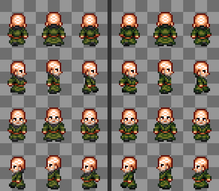
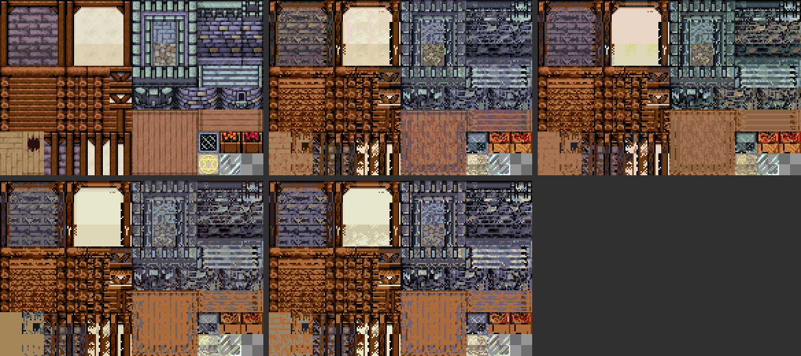
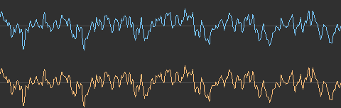
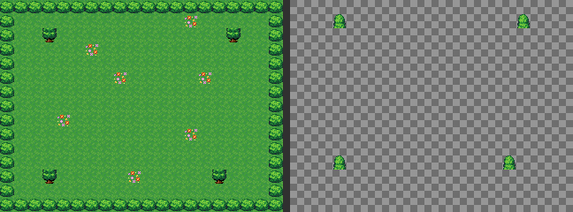
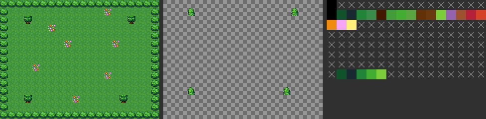
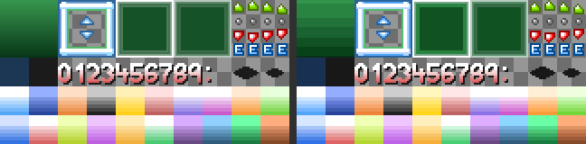
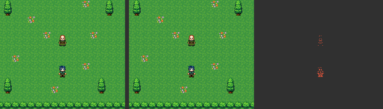
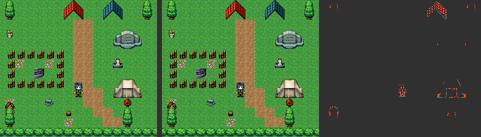
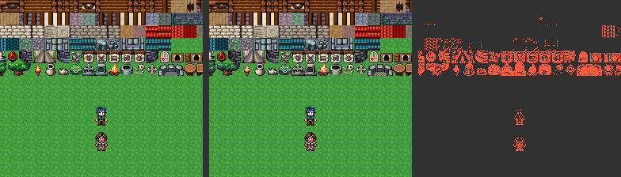

# The tools

An RPG Maker 2000 game is a folder: a database, a map tree and one binary
file per map, next to the PNGs it draws with and the MIDIs it plays. A
Super Nintendo cartridge is one file, the ROM. The tools are the programs
in between: each one is a command on the PATH, written in Rust, that reads
something, decides something and writes something, and says what it
refused. A game's build calls them by name and never calls `cargo`.

This page says which they are, in which order they run and what each one
does; the pages it links to say why things are the way they are.

## The road, in order

```text
RPG Maker 2000 game                        the RTP: the pictures and songs
  RPG_RT.ldb  RPG_RT.lmt  Map*.lmu         the game does not ship
  ChipSet/ CharSet/ System/ … Music/
        │
        │  ditto unpack            once, when the game is brought in
        ▼
data/   one JSON per map, the database, the tree

        │  rm2k-snes-cartridges    once per cartridge the project declares
        │    └─ rm2k-snes-convert
        │          1  rm2k-snes-events scan        which pages compile, every index
        │          2  rm2k-snes-screens window     how many colours the message window takes
        │          3  wally map                    one call per map, in parallel
        │          4  rm2k-snes-battle tables      experience, random encounters
        │          5  rm2k-snes-events compile     every page, the text block, the troops
        │          6  rm2k-snes-screens convert    the menus, the slots, the fonts
        │             rm2k-snes-images …           the title, the pictures, the battle's
        │             rm2k-snes-battle model       what the battle is made of
        │          7  rm2k-snes-mapdata emit   ──▶ mapdata.inc
        │          8  rm2k-snes-patches        ──▶ patches/     what was decided to lose
        │          9  rm2k-snes-audio cartridge──▶ musicdata.inc, <rom>.msu
        │    └─ rm2k-snes-assemble   the runtime's .s + both .inc, ca65 + ld65
        │    └─ rm2k-snes-msu        the MSU-1 tracks, from the MIDIs
        ▼
build/<cartridge>/   <rom>.sfc  <rom>.sfc.sym  <rom>.msu  <rom>-N.pcm
                     degradations.json  patches/  adeleine/
```

Inside the converter the order is not a convenience. The pages have to be
scanned before any map is drawn, because which pages compile decides who
can lead the party, and the hero's poses have to be in video memory before
the leader changes. The message window's colours have to be counted before
the maps, because every map's background starts after them. The maps have
to be built before the pages are compiled for real, because a
`TileSubstitution` is translated to the map's blocks. And the music runs
last because it is the last to decide what is lost, and the list of what
the cartridge does with less than RM2k —`degradations.json`— is written
when it is complete. The what-and-why of each step of the road is in [From
a game to a ROM](pipeline.md); the files each one leaves behind, in [The
pipeline](internals/pipeline.md) under Internals.

### What goes in, what comes out

| Step | Reads | Writes |
|---|---|---|
| `ditto unpack` | the game's `.ldb`, `.lmt` and `.lmu` | `data/`: the same document as JSON, in two views |
| `rm2k-snes-events scan` | `data/`, the project's cases | each variable's and switch's slot, which pages of each map compile and what they send walking |
| `rm2k-snes-screens window` | the System picture | how many colour-memory entries the message window takes, and what it merged to fit |
| `wally map` | one map and its ChipSet, its events' CharSets | the two background layers as tiles, the 16x16 blocks, the sprite bank, the eight object palettes, and what it merged |
| `rm2k-snes-battle tables` | the actors, the tree, the maps' encounters | the experience and level per actor, each map's encounter odds as integers |
| `rm2k-snes-events compile` | every page the cartridge carries | the bytecode of every page, the text block with its pair table, the songs each map asks for |
| `rm2k-snes-screens convert` | the System, the faces, the terms | every screen as tiles and tilemaps, the font precomposed, each face with its palette |
| `rm2k-snes-images …` | the title, the Game Over, the pictures, the backdrops, the battlers, the animation sheets | each one scaled to the console's screen and brought down to its palette |
| `rm2k-snes-battle model` | the skills, the items, the troops | what each one can do, and the battle's text screen laid out |
| `rm2k-snes-mapdata emit` | everything above | `mapdata.inc`: the constants the runtime is built with and every table it reads, the shared blocks as LZ2 streams |
| `rm2k-snes-patches` | what the converter decided | `patches/`: the merged colours, the shrunk animations, the battlers' palettes, as TOML |
| `rm2k-snes-audio cartridge` | the MIDIs, the SoundFont, the sound effects | `musicdata.inc`: the sample bank, a stream per song, a package per map; and the `.msu` |
| `rm2k-snes-assemble` | the runtime and both `.inc` | the ROM, its symbols and its debug file |
| `rm2k-snes-msu` | each song's MIDI, or a replacement recording | one `.pcm` track per song, for an MSU-1 |

## Three layers

The tools are one Cargo workspace in three folders, and each one only
depends on the ones below it. That is what lets either half go somewhere
else: the console's formats to a game that is not from RPG Maker, RPG
Maker's to a port that is not for the console.

| Layer | Knows about | Tools |
|---|---|---|
| `snes/` | the console's formats, nothing of RPG Maker | [Adeleine](#adeleine-which-colours-are-lost), [Voodoo](#voodoo-a-picture-into-tiles), [LZ2](#lz2-nintendos-compression), [Gunter](#gunter-samples-for-the-sound-chip), [Goombario](#goombario-a-linter-for-the-65816) |
| `rm2k/` | RPG Maker 2000's formats, nothing of the console | [Ditto](#ditto-reads-and-writes-the-formats), [the rules](#rm2k-rules-what-the-format-means), [`rm2k-sketch`](#rm2k-sketch-a-map-drawn-as-text), [`rm2k-render`](#rm2k-render-draws-like-rm2k) |
| `rm2k-snes/` | both | [the project](#the-project-and-the-bytecode), [the converter](#the-converter) and [its stages](#the-stages), [the emission](#rm2k-snes-mapdata-the-emission), [the patches](#rm2k-snes-patches-what-was-decided-to-lose), [the cartridge builder](#the-cartridge-builder) |

A test of the tools fails if a crate in `snes/` or `rm2k/` depends on
anything outside its layer, or so much as names the project file.

## The console's side: `snes/`

Nothing here knows what a picture is of, or what a sample is for. These
are the formats the hardware reads, and the decisions that have to be
made to fit them.

### Adeleine: which colours are lost

The console draws a 4-bit background or sprite tile with one palette of
sixteen entries, the first one transparent; a map, a System or a battler
usually has more colours than that, spread in ways no grouping fits.
Adeleine is the one program that **decides which colours go and how the
rest are grouped into palettes**, so that there is a single answer to
"which colour was lost".

- **Reads**: colours with the pixels each one covers, and tiles as the set
  of colours each draws with. Never a picture: the caller counts.
- **Writes**: for `merge`, which colour each one became; for `pack`, the
  palettes, or `null` if the tiles do not fit; for `reduce`, each tile's
  palette and the mapping of its colours.
- **Decides**: the pair that *shows the least* is merged first —the cost
  of sending `a` to `b` is `pixels(a) × distance(a, b)`, the distance
  weighted by luma—, so two near-equal greys over half the sheet melt into
  one and a highlight of a few pixels survives. It never invents a colour,
  and it is deterministic. As a library it also groups similar 8x8 tiles
  into fewer, for a picture with more distinct tiles than video memory
  holds.
- **Refuses**: nothing it can answer; exit 1 when no amount of merging
  fits.

Where the rule is explained against the game: [Lossy:
colours](optimizations/lossy/colours.md), [The CGRAM
split](internals/cgram.md).

**For example, `merge`.** A character of the EasyRPG RTP's `People1`
—the elder of the test game, character 6— uses 21 colours at 15 bits over
its twelve poses, and an object palette holds fifteen. The request is
those 21 colours with the pixels each one covers and `"keep": 15`; the
answer is six merges, each the cheapest left. Before, on the left; after,
on the right:



The six pairs, in the order they were merged —each victim and the colour
it went to—: two near-equal oranges of the skin first, then dark browns
of the hair and the boots, a highlight of the skin, a grey of the
outlines into the coat's darkest green, and two more browns; each the
one that, by pixels times distance, shows the least:


**And `reduce`, on the hardest input there is.** The whole `Exterior`
ChipSet —193 colours at 15 bits over 1,894 drawn cells— asked into
eight, four, two and one palettes of fifteen, which is what the layer
above the hero goes through: `pack` with eight palettes says it does not
fit as it is, and `reduce` groups the cells and chooses each group's
colours. Top row: the original and the eight- and four-palette answers;
bottom row: two palettes and one. The crop is the sheet's middle band,
the house and the stone walls:



No map asks for this: a map draws a few dozen of these tiles, not the
whole sheet, and on the console the layer *behind* the hero is 8 bits a
pixel and takes its colours without any per-cell grouping —only the layer
in front, at 4 bits, is split this way—. What the picture shows is the
shape of the loss when there is one: a cell keeps the colours of the
palette it was put in, and a palette is chosen for a group of cells that
look alike.

### Voodoo: a picture into tiles

Voodoo cuts an indexed picture into 8x8 tiles, numbers the distinct ones
—a mirrored cell is not a new tile—, and writes them the way a planar PPU
reads them: bit planes, a tilemap entry per cell and colour memory as
15-bit words. It **makes no decision anyone could see**: `render` gives
back exactly the indices `convert` was given.

- **Reads**: an 8-bit indexed PNG whose indices *are* colour-memory
  entries: index 37 is entry 37 in every picture, so at 4 bits `index >>
  4` is the palette and `index & 15` the colour inside it.
- **Writes**: the tiles at 4 or 8 bits, the tilemap, the 256 entries of
  colour memory; and an animation's run, for the cells that differ between
  frames.
- **Decides**: nothing. The palettes arrive chosen —by Adeleine, upstream—.
- **Refuses**: a cell that draws with two palettes, a palette a tilemap
  cannot name, more distinct tiles than the caller allows. The message
  names the cell, because fixing that cell is what the caller does next.

That Adeleine decides and Voodoo only converts is a design decision, and
it had a cost: Voodoo once had a `--merge` of its own, and it was removed
so that the answer to "which colour was lost" lives in one place.

**For example.** The meadow's background, as Wally leaves it —an indexed
PNG whose indices are colour-memory entries—, converted at 8 bits a
pixel:

```text
$ voodoo convert background.png --bpp 8 -o meadow.8bpp \
      --palette meadow.cgram --tilemap meadow.map --json
{"output": "meadow.8bpp", "bpp": 8, "columns": 40, "rows": 30, "cells": 1200,
 "tiles": 17, "tile_bytes": 1088, "palettes": 1, "colors": 19, "animations": []}
```

Twelve hundred cells, seventeen distinct tiles: drawn once each, with a
tilemap that counts them, they are the whole meadow's material —the grass
in its few patterns, the bushes' corners, the flowers—:


`render` with the real tilemap gives the picture back identical to the
one that went in. And the ChipSet reduced to eight palettes above, asked
in at 4 bits, is refused:

```text
$ voodoo convert exterior-8.png --bpp 4 -o ex.4bpp --palette ex.cgram --tilemap ex.map
error: the picture needs more than 1024 distinct tiles; a tilemap entry
has ten bits for the tile number
```

Which is right: a tilemap entry has ten bits for the tile number, and
what to do about a sheet that needs more is not Voodoo's to decide.

### LZ2: Nintendo's compression

LC_LZ2 is the LZ format Nintendo used in its own Super NES games: a run of
commands —literal, byte fill, word fill, increasing fill, and a repeat of
up to 1024 bytes from an absolute position in the output— ended by `$FF`.
The absolute address is what makes it cheap to decode on a 65816 with the
output in RAM, and why no stream can decode to more than 65536 bytes. The
maps' blocks, the screens and the pictures travel in it.

- **Reads**: any bytes, up to 65536 per stream.
- **Writes**: the **shortest stream the format allows** and, among the
  shortest, the one with the fewest commands, since the decoder pays a
  fixed time per command. It is a shortest path over the input, not a
  greedy matcher.
- **Refuses**: an input longer than 65536 bytes —where to split it is a
  decision about the consumer's memory—, and a stream with bytes after its
  terminator.

`lz2 stats` prints each stream's size and what commands it has; the
emission uses the library.

**For example.** The meadow's seventeen tiles and its tilemap, the files
Voodoo wrote above, compressed and measured:

```text
$ lz2 compress meadow.8bpp meadow.8bpp.lz2 meadow.map meadow.map.lz2
$ lz2 stats meadow.8bpp.lz2 meadow.map.lz2
{"file": "meadow.8bpp.lz2", "stream": 592, "output": 1088, "literal": 27,
 "byte_fill": 9, "word_fill": 2, "increasing": 0, "repeat": 21}
{"file": "meadow.map.lz2", "stream": 183, "output": 2400, "literal": 8,
 "byte_fill": 0, "word_fill": 0, "increasing": 0, "repeat": 45}
```

The tilemap, which is mostly the same grass tile over and over, goes down
to less than a tenth as repeats of its own output; the tiles, which are
drawings, to about half. `decompress` gives both back byte for byte.

### Gunter: samples for the sound chip

The S-DSP plays BRR: nine bytes for every sixteen samples, and nothing
else —no sample rate, no loop point; those live in the chip's registers—.
Gunter does the two jobs that always turn up together: it **reads a
SoundFont** and takes a sample out of it, and it **encodes PCM into BRR**.

- **Reads**: a `.sf2`, with a selector —a General MIDI program, a drum
  key, a sample by name—; or a mono `.wav`.
- **Writes**: the `.wav` of the sample with its zone's contract —rate,
  loop, the volume envelope—, or the `.brr` with the same contract next to
  it, in prose or as one line of JSON a build script reads.
- **Decides**: for each block of sixteen samples, which of the four
  prediction filters and which shift lose the least; and it says the worst
  error it made.
- **Refuses**: a loop point that does not fall on a block boundary, a
  selector the font has nothing for, and —with `--max-error`— an encoding
  worse than the caller allows.

`decode` plays the codec back to a `.wav`, to hear what it did. The music
stage uses it as a library: [Lossless: audio](optimizations/lossless/audio.md),
[Lossy: audio](optimizations/lossy/audio.md).

**For example.** General MIDI program 0, the piano, out of a free
SoundFont —FluidR3—, into BRR and back:

```text
$ gunter sf2 FluidR3_GM.sf2 --extract program:0 -o piano.wav --json
{"name": "P200 Piano D5(L)", "output": "piano.wav", "frames": 103887, "rate": 32000,
 "root_key": 62, "tuning_cents": 0, "loops": true, "loop_start": 73030, "loop_end": 103885,
 "env_delay_timecents": -12000, "env_attack_timecents": -8359, …}
$ gunter encode piano.wav -o piano.brr --json
{"output": "piano.brr", "samples": 103887, "rate": 32000, "blocks": 6493, "bytes": 58437,
 "loop_block": null, "loop_sample": null, "worst_error_percent": 3.088, "within_limit": true}
$ gunter decode piano.brr -o piano-back.wav --rate 32000
$ gunter info piano.brr
  6493 blocks, 103888 samples
  last block: end, does not loop
  filter 0: 2 blocks
  filter 1: 219 blocks
  filter 2: 3022 blocks
  filter 3: 3250 blocks
  ranges: 2x10 3x532 4x2060 5x1522 6x842 7x899 8x307 9x228 10x89 11x4
```

Sixteen-bit samples went in and nine bytes per sixteen samples came out,
with the worst sample off by three percent of the peak; the same six
hundred samples a little after the attack, before in blue and after in
orange:



The two blocks with filter 0 are the first ones, which have no previous
samples to lean on; the rest chose, block by block, the filter and the
range that lost the least.

### Goombario: a linter for the 65816

The runtime is assembled by `ca65` and linked by `ld65`, and some mistakes
assemble fine and are wrong. Goombario reads the ROM, the debug file `ld65`
writes and the sources, so every instruction is read from where its line
put it and nothing is disassembled by guessing.

- **Reads**: the ROM, its `.dbg`, and the `.s` files following their
  `.include`s, replaying `ca65`'s width state —`.a8`, `.i16`, `rep`, `sep`—.
- **Writes**: findings, one per line, with the file and the line.
- **Checks**: a branch on a flag that a pull left —`pla`, `plx`, `ply` set
  N and Z from what came off the stack, the bug that bit the runtime four
  times—; a routine entered with `jsl` that returns with `rts`; a path that
  leaves something on the stack; an instruction run at a width other than
  the one the source declares.
- **Exceptions**: an `--allow` file, with the why of each one.

It runs over every built cartridge in a game's suite: [How it is
tested](testing.md).

## RPG Maker's side: `rm2k/`

Nothing here knows what a console is. It is RPG Maker 2000's formats, what
they mean, and how the original engine draws them.

### Ditto: reads and writes the formats

RPG Maker's binary formats leave a field out when it holds its default
value, so reading them right means knowing every default; two readers that
each wrote theirs by hand once agreed on a wrong one. Ditto reads the
formats **once**, with the defaults from liblcf's schema, and everything
else reads what it wrote.

- **Reads**: `RPG_RT.ldb`, `RPG_RT.lmt`, `Map*.lmu`.
- **Writes**: the same document as JSON, in **two views from one run**: the
  *exact dump*, with the binary's own shape, which is the one it can write
  back; and the *resolved view*, every field written and every enum a
  number, which needs no schema to read. And the schema itself, as data.
- **Decides**: nothing: it copies somebody else's shape, which is why it
  is called that. Unpacking a game and packing it again gives the same
  bytes.
- **Refuses**: to pack the resolved view, by name, instead of writing a
  file with every chunk in it that nobody ever wrote.

As a library it is the one place in Rust that reads a dump, with the
schema's own types: every stage below reads the game through it. Why a
dump at all: [From a game to a ROM](pipeline.md#why-a-json-dump-and-not-the-game-itself),
[`data/` is the resolved view](decisions/data-is-the-resolved-view.md).

### `rm2k-rules`: what the format means

Ditto says a ChipSet is a list of passability bytes; this says where one
can walk. It is a library of the original engine's rules —which layer
covers which, which page of an event is showing and what it draws, the
experience curve, which troops a step can meet, what a map inherits from
the tree—, and **none of the numbers are its own**: each function says
which of easyrpg-player's or liblcf's it is. The stages use it so that a
rule of RPG Maker is written once.

### `rm2k-sketch`: a map drawn as text

A dump keeps a map's two layers as a grid of tile ids, which diffs well
and draws badly. A sketch is the same map as characters, one per cell, and
a legend that says which lower and which upper tile each character stands
for:

```toml
grid = '''
#####
#.*.#
#####
'''

[legend]
"." = { lower = 4000 }                  # grass
"*" = { lower = 4000, upper = 10018 }   # flowers over the grass
"#" = { lower = 4000, upper = 10007 }   # a bush
```

- **Reads**: the sketch.
- **Writes**: the map's `.tiles`, as `ditto pack` reads it next to the
  map's JSON.
- **Does not do**, yet: choose an autotile's pattern from its neighbours,
  the way the editor does; a legend entry is one id.

The test game's maps are written this way: [The test
game](progress/the-test-game.md). Its meadow is the sketch of the next
example: twenty by fifteen cells, a border of bushes, four trees and some
flowers over the grass, each a character and a legend line.

What comes out is a dump's `.tiles`, a grid of RM2k's ids —`4000` is the
first terrain autotile in its plain pattern, `10007` the bush on the
upper layer— and the thing the renderer below reads:

```text
# 20x15, 300 tiles per layer
# lower
  4000  4000  4000  4000  4000  4000  4000  4000  4000  4000 …
# upper
 10007 10007 10007 10007 10007 10007 10007 10007 10007 10007 …
 10007 10000 10000 10002 10000 10000 10000 10000 10000 10000 …
```

### `rm2k-render`: draws like RM2k

Everything the cartridge draws starts from what RM2k would have drawn.
This draws it, the way the original engine does, and nothing about what
anyone does with the pictures afterwards: a map's two layers stacked
around the hero by the ChipSet's passability, with the other drawings of
its water and its animated tiles; a ChipSet expanded into every tile it
can draw —32 by 45, every combination of every autotile—; what events are
drawn with, a translucent one blended over what is behind it; faces cut
from their FaceSets; the System's windows, cursors and text colours; the
pictures of `ShowPicture` with their transparent colour; a battle
animation's cells placed as RM2k places them; backdrops and enemies.

- **Reads**: a map from the dump, or as a request a caller changed; the
  pictures from the game's folder and then the RTP's, without regard to
  case, since the games were made on a system that did not care.
- **Writes**: RGBA PNGs at eight bits.
- **Decides**: nothing of its own; where the line is drawn is whether a
  viewer of the game on a PC would draw it the same way.

The goldens of a port's suite are compared against the console, not
against this; it is what the stages start from, and what the tests use to
predict the console with.

**For example.** The meadow's two layers, from the test game's dump:

```text
$ rm2k-render layers --map 1 --data build/data --game-dir build/game \
      --rtp-dir empty/ --out meadow/
```

`lower.png`, what is drawn behind the hero on opaque black, and
`upper.png`, what is drawn in front of them on transparency —here, the
four trees' crowns, which the ChipSet's passability puts above—:



## Both sides: `rm2k-snes/`

What joins the two: an RPG Maker game made into a cartridge. One program
orchestrates, the converter; the rest are **stages**, each a program on the
PATH with the same shape. A stage reads the game from the dump itself,
with Ditto's library; gets in a **request** what the cartridge decided and
the dump does not say; and writes pieces and a JSON into a directory. A
rule of RPG Maker is `rm2k-rules`', a format of the console is
`snes/`'s, and what a stage keeps is what belongs to the cartridge.

### The project and the bytecode

Two libraries the rest is built with.

**`rm2k-project`** answers which game is being built and what it decided:
a game declares itself with an `rm2k-snes.toml` at its root, and the tools
find it from where they run upwards, the way cargo finds its `Cargo.toml`.
**A missing key is an error that names the key, never a default**, since a
default would be one game's value, and another game would be built with
it in silence. Where the machine keeps the original game, the RTP and the
SoundFont arrives by flags —`--game-dir`, `--rtp-dir`, `--soundfont`—, a
`.zip` or a directory, with no default either. Its one binary,
`rm2k-snes-project`, prints the project as the tools resolve it, for a
game's tests to ask instead of reading the file themselves.

**`rm2k-snes-bytecode`** declares the two bytecodes the cartridge reads
—the events' and the music stream's— **once**. A bytecode has two sides
that have to agree byte for byte, and when each writes the numbers down
for itself they drift, and the result does not fail: it reads from the
middle of the next instruction and carries on. So the Rust side takes the
constants with a `use`, and the assembler's equates are written next to
the cartridge at every build; a repeated number, a gap or a name both
bytecodes use stops the compilation. What each opcode does is still
hand-written on both sides.

### The converter

`rm2k-snes-convert` runs once per cartridge, and **asks each stage, in
order, what the cartridge needs, and hands each one what the others
answered**. What it decides itself is only what joins them —none of it is
a rule of RPG Maker nor a format of the console—:

- **which maps and which test pages** the cartridge carries, in table
  order, which is the order a compiled teleport counts in;
- **who can lead the party** in each map, by simulating the
  `ChangePartyMembers` of the pages that compile;
- **which items and actors** need a name and a face, **where the timer can
  run**, and whether it rains;
- **which pictures, animations, backdrops and battlers** go in, and where
  each lands;
- **the checks of the compiled pages** against the runtime's caps, which
  the console cannot warn about.

And it writes, next to the ROM, two things that are the game's to look at:
`degradations.json`, every place where the cartridge runs something with
less than RM2k, noted where the loss happens and not kept in a list by
hand —[The pipeline](internals/pipeline.md#what-the-cartridge-does-with-less-than-rm2k)—,
and `adeleine/`, what Adeleine decided for each map as indexed pictures,
to look at which colours were lost without building the ROM.

### The stages

**`wally`**, the maps, one call per map and in parallel. A map on the
console is two background layers in mode 3 —the one behind the hero at 8
bits a pixel, the one in front at 4—, the events as 32x32 objects in eight
palettes of fifteen colours, and a table of 16x16 blocks the console
redraws its tilemap window from. Its two halves do not know each other:
the *background* splits the lower half of colour memory between the two
layers map by map —the background gets first pick, the layer above takes
what is left and merges if it must—, cuts the layers to 15 bits, fuses the
most similar tiles only when no VRAM layout holds them all, and makes the
blocks; the *sprites* split the eight palettes among the characters —the
leader candidates first and alone, the rest while they fit and borrowing
someone else's colours when they do not—, fill the VRAM bank with one pose
per slot and the bank of the twelve poses of whoever changes pose, and
put the timer's digits, the raindrops and the battle animation's box at
the end. An opaque event drawn with a ChipSet tile that never moves is
**baked** into the layer instead of being a sprite. A map that fits no
layout is tried again with its still events taking turns in a slot, then
with a cache of slots whoever comes into view asks for, and refused only
after that. What it decides, against the game: [Lossy:
colours](optimizations/lossy/colours.md), [Lossy:
tiles](optimizations/lossy/tiles.md), [Lossless: the
map](optimizations/lossless/the-map.md), [Characters and
sprites](optimizations/lossless/characters-and-sprites.md), [The CGRAM
split](internals/cgram.md), [The VRAM split](internals/vram.md),
[Maps](internals/maps.md).

*For example*, the background half alone, on the meadow, with the
message window's count from the screens:

```text
$ wally layers --data build/data --search-dir build/game \
      --request layers.json --out meadow/
```

where `layers.json` is `{"map": 1, "map_files": {}, "chipset_files": {},
"baked": [], "window_colors": 15}`. Out come the two layers as indexed
pictures whose indices are colour-memory entries —what Adeleine decided—,
their tiles and tilemaps, and `layers.json` with the numbers: the
background used 19 colours of a budget of 96, with no merges, and the
layer above took palette 7, with none either. On the right, the lower
half of colour memory as the meadow leaves it, one square per entry:
entry 0 is the backdrop, entries 1 to 15 are the message window's —not
drawn by the map, so crossed—, the background's colours start at 16, and
the layer above's palette is the last row:



The layers came back identical to what `rm2k-render` drew: nothing was
lost on this map. The ones where something is are further down this
page, under "The same ChipSet, three times".

**`rm2k-snes-events`**, the event compiler, called twice. RM2k has about
130 event commands and a page is a script of them; the console runs a
bytecode with every operand already resolved —an event is its index in the
map's table, a variable its slot in RAM, a text its offset in the ROM's
text block—. The rule is one: **a page is emitted only if all of its
commands can be run**; one the console does not model leaves the whole
page out, since running half a script would leave the game in a state
that does not exist. `scan` compiles every page on its own, before any
map is drawn, to learn the indices and which pages compile; `compile`
compiles them all for real, with the text block, the songs and the troops,
after the maps exist. `culprits` is for people: which commands keep each
page out. More: [Events](internals/events.md), [Lossless:
events](optimizations/lossless/events.md), [Lossy:
events](optimizations/lossy/events.md), [What the compiler ignores
silently](research/2026-10-14-what-the-compiler-ignores-silently.md).

**`rm2k-snes-battle`**, the battle, called twice too. `tables` computes
ahead of time what the console only reads: RM2k's experience curve —in
floating point, which the console does not have— for every level of every
actor, and each map's random encounters with the odds per step turned
into integers the console shifts and compares. `model` answers what the
battle is made of —which skills, to whom, what each enemy can do, which
items, what a troop gives— and lays out its text screen on the grid of
cells. `simulate` plays a battle turn by turn with the console's rules
and randomness, for the tests to compare against. More: [Lossless:
battle](optimizations/lossless/battle.md).

**`rm2k-snes-screens`**, with `rm2k-snes-text` under it, draws once what
is not a map or a battle: the message window cut into tiles and its font
precomposed for each of the eight places a letter can land in a cell, the
title's menu, the save slots and the pause menu —which share a tile bank,
with each actor's face brought to a palette—, the text screens' inks, the
windows behind them, End Game, the skills screen, and every message box of
the game **reflowed** for a window narrower than RM2k's. Before all that,
`window` counts how many colour-memory entries the message window takes
from the System, since the maps' backgrounds start after them, and merges
the System's colours when it has more than fifteen. More: [Text and
windows](optimizations/lossless/text-and-windows.md), [A window with a
gradient](optimizations/lossy/tiles/a-window-with-a-gradient.md), [The
windows, made cheaper](research/2026-10-11-the-windows-made-cheaper.md).

*For example*, `window` on the test game, whose System is the RTP's:

```text
$ rm2k-snes-screens window --data build/data --game-dir build/game \
      --rtp-dir empty/ --request empty.json --out window/
```

with `{}` in `empty.json`: the test game switches to no other System.

The window draws with 30 of the System's colours and palette 0 gives it
fifteen, so the answer is fifteen merges, each the least visible left:
thirteen are greens of the gradient behind the text, which keeps its
bands and loses the shades in between, and two are light blues that go
to their neighbours. The whole System picture before and after, so that
what moved can be seen —the window only draws with its upper half and the
text colours—:




**`rm2k-snes-images`**, the pictures: the title and the Game Over at 8
bits a pixel, the picture of a `ShowPicture` as a sprite or —too big for
the sprites— as a 4-bit layer, the battle's backdrops in quality and in a
light fallback, the battlers turned by their hue and cut at half their
alpha, and the animations toned with the console's arithmetic, stacked,
shrunk until they fit their box, with one palette chosen over every frame.
It scales with the `image` crate, brings colours down with Adeleine and
cuts tiles with Voodoo; which pictures go in, and where, is the
converter's. More: [Pictures and
animations](optimizations/lossy/pictures-and-animations.md), [The picture
system](research/2026-10-01-the-picture-system.md).

**`rm2k-snes-audio`**, the music, last. A game's songs are MIDIs written
for a General MIDI synthesizer with as many voices as it wants; the S-DSP
has eight voices playing samples out of 64 KB. From each MIDI and the
SoundFont the game was composed with, it builds one sample per program and
per percussion key, shared by every song and each with the budget of its
worst package; a stream per song that says what each voice plays frame by
frame; and a **package** per map, the samples it has to have in sound RAM
when it is entered. It writes `musicdata.inc` and the `.msu`, and what a
package lost to fit, which the converter adds to `degradations.json`.
Next to it, `rm2k-snes-msu` renders the MSU-1 tracks from the same MIDIs
with fluidsynth, or takes a recording that replaces one, and
`rm2k-snes-volume-ceilings` measures each song's headroom. More:
[Audio](internals/audio.md), [A single sample
bank](optimizations/lossless/audio/the-sample-bank.md), [Lossy:
audio](optimizations/lossy/audio.md), [The .msu
file](internals/the-msu-file.md).

### `rm2k-snes-mapdata`: the emission

The runtime —the engine, in 65816 assembly— is assembled together with one
`.inc` of data: the constants it is built with and every table it reads.
`emit` writes that file from what every other stage answered, and
**decides nothing that is not about how the cartridge carries it**: which
blocks are shared between maps, how each is cut into LZ2 streams and
whether each fits where the console decompresses it, which segment each
table goes in. It also owns the **VRAM layouts**, the contract with the
runtime that says where a map's tiles, tilemap, sprites and window go: the
maps and the screens read them from here, and `vram` publishes them. A
ChipSet animation whose drawings do not fit their WRAM area is cut here,
and said. More: [The VRAM split](internals/vram.md), [The
cartridge](optimizations/lossless/the-cartridge.md), [The binary emitter
ships with a sourcemap](decisions/the-binary-emitter-ships-with-a-sourcemap.md).

### `rm2k-snes-patches`: what was decided to lose

Everything the conversion decided to lose —which colour was merged with
which in each layer, how a map shows its panorama, at what size each
battle animation is drawn, which fifteen colours each battler was reduced
to— is written as TOML next to the ROM, copied into the project with the
playable cartridge's decisions, and **checked against every cartridge**:
a change in the tools that moves a decision shows as a diff someone has
to look at, not as a pixel nobody notices. The decisions travel in the
converter's request; the text they are written as is this program's.

### The cartridge builder

Three programs share one library.

- **`rm2k-snes-cartridges`** knows which cartridges the project declares
  —`release`, the one that is played, is required and carries every
  case— and builds the stale ones: it runs the converter, the assembler
  and the MSU-1 tracks for each. A cartridge is stale when its **stamp**
  no longer matches: the converter's flags, its cases, and a fingerprint
  of everything that goes into the ROM by content, never by date —the
  whole runtime, the binaries that build, the dump, the project file, the
  original game's pictures and songs—. `--list --json` is what a game's
  tests read instead of knowing any of this.
- **`rm2k-snes-assemble`** packs what the two `.inc` send to `RODATA` into
  banks, writes the bytecodes' equates, runs `ca65` and `ld65` with the
  runtime, fixes the header's checksum and writes the symbols. It refuses
  to build if a generated `.inc` is found inside the runtime's folder,
  since `ca65` would take it over the cartridge's without a word.
- **`rm2k-snes-space`** prints how much each bank and each RAM area has
  left, for any cartridge or a ROM built elsewhere, **and writes it down
  nowhere**: how much is left is a property of the build, not of the
  documentation.

More: [ExHiROM, 8 MB](internals/exhirom.md), [The cartridge goes to 8
MB](decisions/the-cartridge-goes-to-8-mb.md), [RAM is placed by the
linker](decisions/ram-is-placed-by-the-linker.md).

## The same ChipSet, three times: nothing lost, a little, too much

Which colours a map loses depends on the map, not on the ChipSet: on how
many colours it draws behind the hero, which share one 8-bit background
with a budget, and how many in front of them, where every 8x8 cell draws
with one of the palettes the background leaves. The test game has three
maps on the same `Exterior` ChipSet, made for this: each one as RPG Maker
2000 draws it, as the console draws it, and where the two differ at 15
bits, marked in red. The console's side is the test game's golden for
that map —what snes9x drew, and bsnes the same—; the original's is a
capture of RPG_RT running the folder the test game makes, cut to the
console's window.

**The meadow: nothing lost.** Grass, bushes, flowers and four trees whose
crowns are the only thing in front of the hero. The converter's report
for it:

```text
Map 1 'Meadow': 40x30 cells of 8x8 px
  19 distinct colors, 19 in CGRAM of 96 available, 0 merged
  17 unique tiles of 1200 cells (99% reuse)
  layer above the hero: 5 tiles, 16 colors in 1 palette(s) from 7, 0 merged
```



The red is the two characters: each sprite gets fifteen colours, and the
elder and the hero have a few more, so Adeleine merged those —the first
example of this page, on the elder—. The map itself is identical.

**The garden: a little.** The meadow's grass with a path, a fence around
a well, and in front of the hero two roofs, a dome and a tent —what a
game author marks ★ in the ChipSet so that the hero walks under them—.
The background keeps every colour it draws; the layer in front asks for
48 and gets the three palettes the background leaves, so sixteen go:

```text
Map 2 'Garden': 40x30 cells of 8x8 px
  61 distinct colors, 61 in CGRAM of 64 available, 0 merged
  49 unique tiles of 1200 cells (96% reuse)
  layer above the hero: 71 tiles, 48 colors in 3 palette(s) from 5, 16 merged
```



The dome comes out a shade greyer and the tent a shade flatter; the
roofs lose a pixel along their edges. It is the loss a player does not
notice unless the two are side by side.

**The showcase: too much.** Ninety-six of the ChipSet's lower tiles, one
each, and its forty most coloured upper tiles, every one of them in front
of the hero through a second ChipSet entry with every upper tile ★. No
game draws a map like this; it is as much as the biggest VRAM layout
holds, and the worst the engine allows: the background asks for more than
its budget, and the layer in front, which would need at least five
palettes for its 64 colours, is left one:

```text
Map 3 'Showcase': 40x30 cells of 8x8 px
  117 distinct colors, 96 in CGRAM of 96 available, 21 merged
  320 unique tiles of 1200 cells (73% reuse)
  layer above the hero: 150 tiles, 16 colors in 1 palette(s) from 7, 49 merged
```



The front row is where it shows: the barrels, the pots, the lanterns and
the stones drawn with fifteen colours between all of them, browner and
greyer than they were. The background, two rows above, lost twenty-one
of its hundred and seventeen and it takes the red mask to find them,
because what Adeleine merges first is what shows the least.

The three maps live in the-advocate's `test-game/`, sketched as text
—`src/maps/Map0001.toml` to `Map0003.toml`— and each has its golden in
`tests/golden/`, so a change in Adeleine or in Wally that moves a merge
shows on a map small enough to look at.

## Two decisions worth knowing before reading any of it

- **Adeleine decides which colours are lost**, and Voodoo only converts a
  picture that already fits and refuses one that does not. The test for
  which side something belongs to: does it change a pixel of what is seen?
- **The event compiler leaves a page out whole** rather than run part of
  it, and a report says which command kept which page out. Something the
  console can do with less than RM2k is done with less, declared as debt
  in `degradations.json`.

## Running them by hand

Each binary prints what it reads and what it writes with `--help`, and
each subcommand prints the shape of its request and its answer. A stage
can be run alone on a dump, with a request written by hand; the pieces it
writes are the same ones the converter hands to the next stage. The
converter's queries —`scan`, `compile`, `leaders`, `map-context`,
`boxes`— answer a game's tests the same questions it asks itself.

### How the pictures on this page were made

Every picture above comes out of two scripts in `figures/tools/`, at the
root of this book's repository. `make.py` counts pixels, writes each
tool's request, runs the tool from the PATH and pastes the answers side
by side; it takes the EasyRPG RTP, a SoundFont and the test game's
`build/` —made with `just game` in the-advocate's `test-game/`— as flags,
and prints what each command printed, which is where the numbers quoted
above were read from on the day the pictures were made; the tools move,
so the way to know today's is to run it again. `grades.py` makes the
three-way pictures of the graded maps from the test game's goldens and
the originals kept next to it in `originals/`: a capture of RPG_RT, which
nothing here can run, so those are made by hand when a map changes. The
converter's reports are from the test game's `build/release/converter.log`.

The pictures are the [EasyRPG RTP](https://github.com/EasyRPG/RTP)'s:
`ChipSet/Exterior.png` by Jason Perry, CC0, and `CharSet/People1.png`
by VictorSena and `System/System.png` by andwhyisit, both CC BY 4.0. The
piano is the one FluidR3's General MIDI bank carries at program 0.

The tools are installed on the PATH with `just install`, from the root of
the-advocate, the tools' repository; its `LAYOUT.md` says where each one
lives, and how a checkout that changes one installs its own copy first on
the PATH of its recipes.
